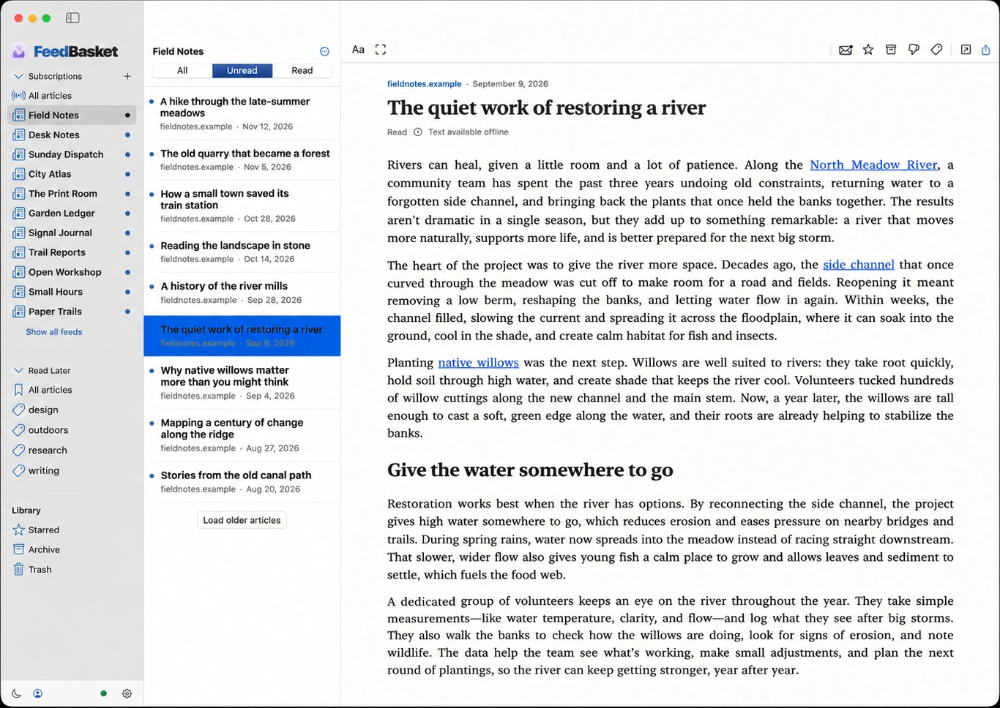

# FeedBasket

FeedBasket is an RSS reader and read-it-later app combined into one. It comes with a chrome extension to save articles directly; and a macos native app for reading.

## Why Another Feed/Read-it-Later app?

Most such apps are paid; or do not support both functionalities: i.e. RSS Reader and Read it Later. Moreover, they do not let the user own the data. In the age of AI, when coding has become so simple, users shouldn't be paying for using such a simple & basic functionality.

FeedBasket is

- Open Source and Free
- Fully self-hosted.
- You fully own the data.

## Screenshot

RSS reader on macOS with sample articles and feeds.



## 1. Start the backend

From the repo root, copy `.env.example` to `.env` and set `ADMIN_USER` and `ADMIN_PASSWORD`. Git ignores `.env`. Set `DB_DIR`, `LOGS_DIR`, and `BACKUP_DIR` there using absolute paths. Both launch methods use those folders. The database file is `feedbasket.sqlite`. Stop one backend before starting the other.

Use those credentials to open Admin. Create a unique reader username in the Mac app, Chrome, or Admin. Sign in with the same username in both clients. Anyone who can reach your backend and knows your username can open your library.

If you're upgrading, stop the backend before moving an existing `feedbasket.sqlite` to `DB_DIR`. If the file still uses the old product name, rename it after a clean shutdown.

### Docker

You need Docker with Compose and Python 3 on the host for the startup script.

From the repo root, run these on first setup:

```sh
python3 scripts/start-docker.py
```

The script creates missing folders on your machine before starting Docker. Compose mounts them at the same paths inside the container. Open Admin and sign in. [Docker Admin](http://127.0.0.1:12000/admin)

### CLI

You need Python 3.12+ and `uv`.

```sh
cd backend
cp -n feedbasket.example.toml feedbasket.toml
uv run --locked --env-file ../.env feedbasket
```

The CLI creates missing folders on startup. Admin shows the backup destination from `.env` and lets you change the schedule and retention. [CLI Admin](http://127.0.0.1:8787/admin)

For local development, add `--reload` to restart the backend automatically when Python source files change:

```sh
uv run --locked --env-file ../.env feedbasket --reload
```

Prefer pip? From `backend/`, run `pip install .` in an activated virtual environment. Export the admin variables before running `feedbasket` directly. For the optional Mozilla Readability fallback on a CLI install, run `npm ci` in `backend/` using Node.js 22.12+ LTS.

### Accounts and backups

- **Admin** lets you add accounts, manage feed jobs, and schedule or run SQLite backups. A Google Drive–synced folder works for snapshots.

Existing local accounts with a unique, valid display name can sign in using that name as their username. For other existing local accounts, stop the backend and run `feedbasket account --list`, then `feedbasket account USERNAME --existing-id UUID` with the same backend configuration.

## 2. Build and load the Chrome extension

You need Chrome 120+ and Node.js 22 LTS with npm. Run from the repo root:

```sh
cd apps/chrome
npm ci
npm run build
```

1. Open `chrome://extensions` and turn on **Developer mode**.
2. Click **Load unpacked** and select `apps/chrome/dist`.
3. Open FeedBasket from the toolbar and sign in with your username.

The default API URL is `http://127.0.0.1:12000`. If you used the CLI, set it to `http://127.0.0.1:8787` in the popup settings. Purple means the backend is reachable. Gray means it is offline. The badge shows queued saves.

## 3. Build and open the Mac app

You need macOS 14+ and the macOS SDK with Swift 6+ from Xcode or Command Line Tools. From the repo root:

```sh
./apps/macos/build-app.sh
open "apps/macos/dist/FeedBasket.app"
```

Use the account menu to sign in or create an account with a username. FeedBasket remembers the account for each server and reconnects automatically on launch. It keeps the server token in memory. Signing out clears the remembered account for that server.

The app defaults to port `12000`. For the CLI backend, change it to port `8787` in **Settings → Connection**. **Settings → Storage** shows how much space offline articles use and lets you clear copies by date or all at once.

## Sync and logs

A new RSS subscription imports up to 10 articles dated within the past year. Use **Load older articles** to import earlier or undated posts in batches of up to 10.

Saved articles show up in the open Mac app as soon as it receives a backend update and syncs. The app catches up from its last saved position on launch or reconnect. Feed fetching still follows each feed’s schedule.

- **Backend:** `feedbasket.log` in `LOGS_DIR`. It rotates at 5 MiB and keeps three previous files.
- **Mac:** **Settings → Diagnostics** opens or copies recent logs. Files are in `~/Library/Logs/FeedBasket`. Rotation is 1 MiB with three previous files.
- **Chrome:** Open **Diagnostics** in the popup. It keeps the last 200 entries in local extension storage.

## Tests

From `backend/`:

```sh
uv run --locked pytest --cov=feedbasket
```

The suite uses temporary SQLite files and captured publisher data. Coverage excludes `auth.py`. Use `FEEDBASKET_LIVE_TESTS=1` to include the live NASA test. The running backend also serves interactive API docs at `/docs`.
