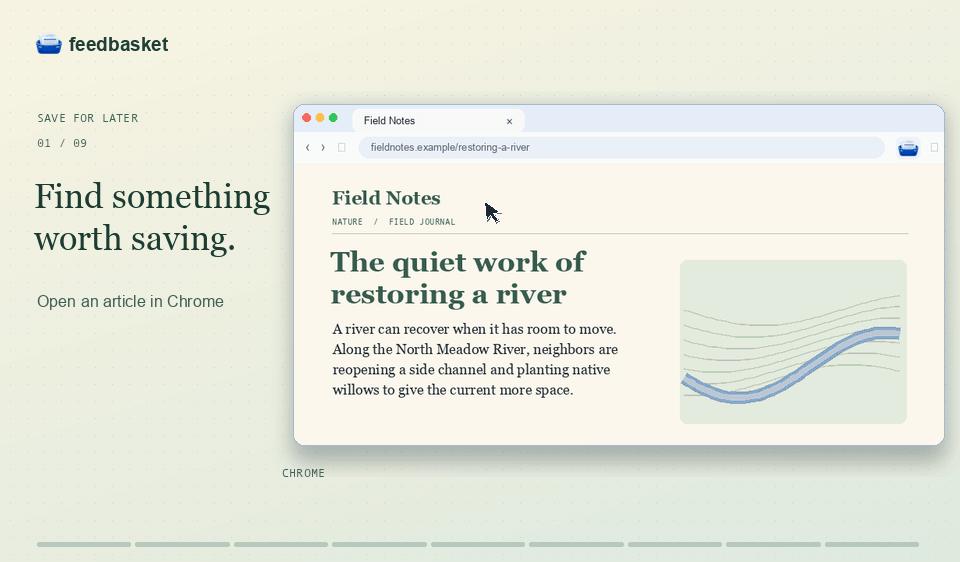
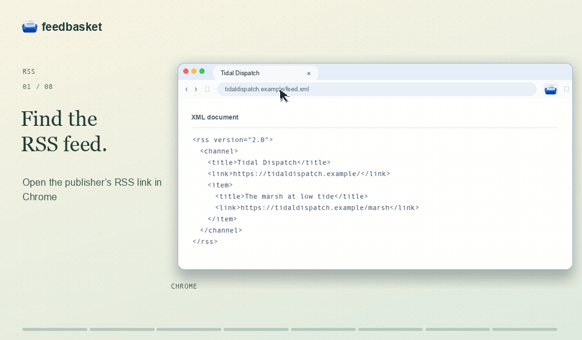
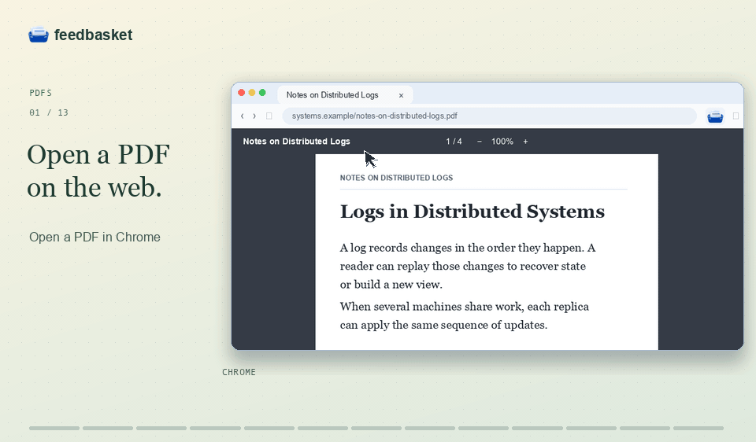

# FeedBasket

FeedBasket is a self-hosted RSS reader and read-it-later app for articles and PDFs. Save links from Chrome, then read and highlight in the native macOS app.

## Why Another Feed/Read-it-Later app?

Most such apps are paid; or do not support both functionalities: i.e. RSS Reader and Read it Later. Moreover, they do not let the user own the data. In the age of AI, when coding has become so simple, users shouldn't be paying for using such a simple & basic functionality.

FeedBasket is

- Free and open source under the [MIT License](LICENSE).
- Fully self-hosted.
- You fully own the data.

## Workflow demos

These animated demos use fictional articles, feeds, and PDFs.

### Save for Later

Tag and save an article from Chrome. Open it on Mac, change the reading font and text size, and archive it when you’re done.



### RSS

Subscribe to a feed from Chrome. On Mac, filter to unread, read a story, load older posts, and star a favorite.



### PDFs

Save a PDF link from Chrome or upload a file from Mac. Highlight and underline passages, search in Focus Mode, and return to your saved page or highlight.



## 1. Start the backend

From the repo root, copy `.env.example` to `.env` and set `ADMIN_USER` and `ADMIN_PASSWORD`. Git ignores `.env`. Set `DB_DIR`, `LOGS_DIR`, and `BACKUP_DIR` there using absolute paths. Both launch methods use those folders. The database file is `feedbasket.sqlite`. Stop one backend before starting the other.

Use those credentials to open Admin. Create a unique reader username in the Mac app, Chrome, or Admin. Sign in with the same username in both clients. Anyone who can reach your backend and knows your username can open your library.

If you're upgrading, stop the backend before moving an existing `feedbasket.sqlite` to `DB_DIR`. If the file still uses the old product name, rename it after a clean shutdown.

### Docker

You need Docker with Compose and Python 3 on the host for the startup script.

From the repo root, run these on first setup:

```sh
python3 scripts/start-docker.py
```

The script creates missing folders on your machine before starting Docker. Compose mounts them at the same paths inside the container. Open Admin and sign in. [Docker Admin](http://127.0.0.1:12000/admin)

### CLI

You need Python 3.12+ and `uv`.

```sh
cd backend
cp -n feedbasket.example.toml feedbasket.toml
uv run --locked --env-file ../.env feedbasket
```

The CLI creates missing folders on startup. Admin shows the backup destination and the next scheduled run. [CLI Admin](http://127.0.0.1:8787/admin)

For local development, add `--reload` to restart the backend automatically when Python source files change:

```sh
uv run --locked --env-file ../.env feedbasket --reload
```

Prefer pip? From `backend/`, run `pip install .` in an activated virtual environment. Export the admin variables before running `feedbasket` directly. For the optional Mozilla Readability fallback on a CLI install, run `npm ci` in `backend/` using Node.js 22.12+ LTS.

### Accounts and backups

- **Admin** lets you add accounts, manage feed jobs, and run SQLite backups. Automatic backups run at midnight in `Asia/Kolkata`. Sunday's snapshot is also copied to `weekly/`. Both `daily/` and `weekly/` retain their two newest snapshots. **Back Up Now** writes to `daily/` and leaves the next scheduled run in place.

Set `BACKUP_PREFIX` to the relative path containing `daily/` and `weekly/`. Its default is `backups/`. When the R2 connection fields are set, FeedBasket stores backups at `s3://<bucket>/<BACKUP_PREFIX>/`. The R2 credentials need object read, write, list, and delete access to the bucket. For local storage, set `BACKUP_DESTINATION=local` and use `BACKUP_DIR` as the base folder. Local storage is also the default when the R2 connection fields are empty. A Google Drive–synced folder works as a local destination. Existing snapshots outside the new folders remain available for restore.

To restore a snapshot, download the SQLite file first if it is stored in R2. Stop the backend, move the current database and any `-wal` and `-shm` files aside, then copy the snapshot to `DB_DIR/feedbasket.sqlite` and start the backend. The Mac app shows the backend as offline while it is stopped. After reconnecting, it reloads the restored library and its offline copies.

Existing local accounts with a unique, valid display name can sign in using that name as their username. For other existing local accounts, stop the backend and run `feedbasket account --list`, then `feedbasket account USERNAME --existing-id UUID` with the same backend configuration.

## 2. Build and load the Chrome extension

You need Chrome 120+ and Node.js 22 LTS with npm. Run from the repo root:

```sh
cd apps/chrome
npm ci
npm run build
```

1. Open `chrome://extensions` and turn on **Developer mode**.
2. Click **Load unpacked** and select `apps/chrome/dist`.
3. Open FeedBasket from the toolbar and sign in with your username.

The default API URL is `http://127.0.0.1:12000`. If you used the CLI, set it to `http://127.0.0.1:8787` in the popup settings. The toolbar basket is bright blue when the backend is reachable and muted blue when it is offline. The badge shows queued saves.

Click **Add tags…** for recent tags, or type to search your tags or create a new one. When the page offers a feed, the popup shows **Save**, **Save + subscribe**, and **Subscribe**. Open a known RSS or Atom URL directly to subscribe to it.

After you rebuild an unpacked extension with `npm run build`, open the popup and click the **Update ready** arrow beside Settings to reload it. If your installed copy predates this indicator, reload FeedBasket once from `chrome://extensions`.

## 3. Build and install the Mac app

You need macOS 14+ and the macOS SDK with Swift 6+ from Xcode or Command Line Tools. From the repo root:

```sh
./apps/macos/build-app.sh --install
open "$HOME/Applications/FeedBasket.app"
```

Running the script without `--install` builds `apps/macos/dist/FeedBasket.app` for direct use.

When a new build replaces the running copy in `~/Applications`, an up-arrow chip appears beside the sidebar logo. Click it to restart or keep reading and restart later.

Use the account menu to sign in or create an account with a username. FeedBasket remembers the account for each server and reconnects automatically on launch. It keeps the server token in memory. Signing out clears the remembered account for that server.

The app defaults to port `12000`. For the CLI backend, change it to port `8787` in **Settings → Connection**. **Settings → Storage** shows how much space offline articles use and lets you clear copies by date or all at once.

## Save and read PDFs

- **Save from macOS.** Click **+ Add** to paste a PDF link, choose a file, or drag one into the window. FeedBasket stores the URL for a linked PDF and uploads local files to Cloudflare R2. Find both under **Read Later → PDFs**, with the same tags you use for articles. When the sidebar is hidden, **+ Add** moves to the window toolbar.
- **Save from Chrome.** Open the FeedBasket popup on a PDF tab and choose **Save PDF link**. If detection is inconclusive, open the popup’s settings and select **Save as a PDF link**.
- **Navigate and search.** Click the current page number, enter a destination, and press Return. Press **⌘F** to see the match count and move between results. Focus Mode puts page and zoom controls in a floating bar at the bottom. FeedBasket saves your reading position so you can resume from it.
- **Highlight or underline.** Select text and choose **Highlight** or **Underline** beside the selection. Open **Library → Highlights** to jump back to a saved passage.
- **Manage storage.** View separate article and PDF quotas in **Settings → Storage**. A saved link uses no R2 storage. To remove an upload from R2, move it to Trash and choose **Delete Permanently**.

## PDF backend

PDF links use the existing library API. Save one with `POST /api/v1/articles` and `document_type: "pdf"`. The backend also recognizes URLs ending in `.pdf`. `GET /api/v1/links/preview?url=…` identifies direct feeds, articles with optional feed choices, PDFs, and unsupported files.

To enable file uploads, set `R2_ENDPOINT_URL`, `R2_BUCKET`, `R2_ACCESS_KEY_ID`, and `R2_SECRET_ACCESS_KEY` in `.env`. Use a private bucket and an R2 S3 key scoped to it with Object Read & Write permissions. `PDF_PREFIX` defaults to `pdfs/`. Both Docker and the CLI use these settings.

The import API accepts a raw PDF body up to 100 MiB with `filename`, an `import_id` UUID, and optional repeated `tags` query parameters. Reuse the import ID when retrying the same file. The default PDF quota is 5 GB per account, separate from the article body quota. A file in Trash counts until its R2 deletion succeeds. SQLite backups include PDF metadata and object keys. Back up the R2 files separately to recover files after permanent deletion.

The running backend documents the PDF reader endpoints, reading position, highlights, and permanent deletion in `/docs`.

## Sync and logs

A new RSS subscription imports up to 10 articles dated within the past year. Use **Load older articles** to import earlier or undated posts in batches of up to 10.

Saved articles show up in the open Mac app as soon as it receives a backend update and syncs. The app catches up from its last saved position on launch or reconnect. Feed fetching still follows each feed’s schedule. Publisher jobs have a shared 60-second deadline for requests and redirects. If **Load older articles** reaches that deadline after reading some pages, it saves its progress for the next request.

- **Backend:** `feedbasket.log` in `LOGS_DIR`. It rotates at 5 MiB and keeps three previous files.
- **Mac:** **Settings → Diagnostics** opens or copies recent logs. Files are in `~/Library/Logs/FeedBasket`. Rotation is 1 MiB with three previous files.

## Tests

From `backend/`:

```sh
uv run --locked pytest --cov=feedbasket
```

The suite uses temporary SQLite files and captured publisher data. Coverage excludes `auth.py`. Use `FEEDBASKET_LIVE_TESTS=1` to include the live NASA test. The running backend also serves interactive API docs at `/docs`.

### Live Cloudflare R2 smoke test

With the R2 credentials in the repo's `.env`, run from `backend/`:

```sh
FEEDBASKET_LIVE_R2_TESTS=1 uv run --locked --env-file ../.env pytest tests/test_live_r2.py
```

The test creates the `tests/` folder marker if needed. It uploads a generated PDF through the backend into a unique prefix under `tests/`, downloads and compares the bytes, then deletes that PDF. The folder marker remains visible in Cloudflare. The default suite uses a local object-storage endpoint.
